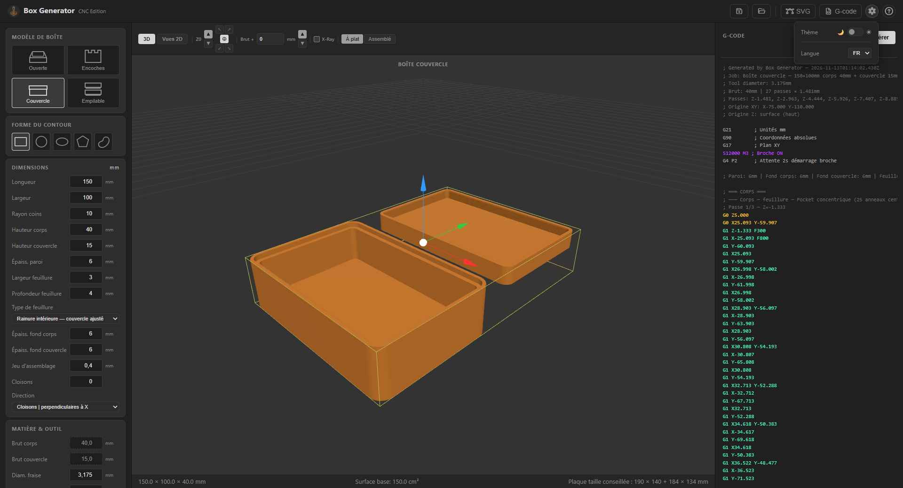
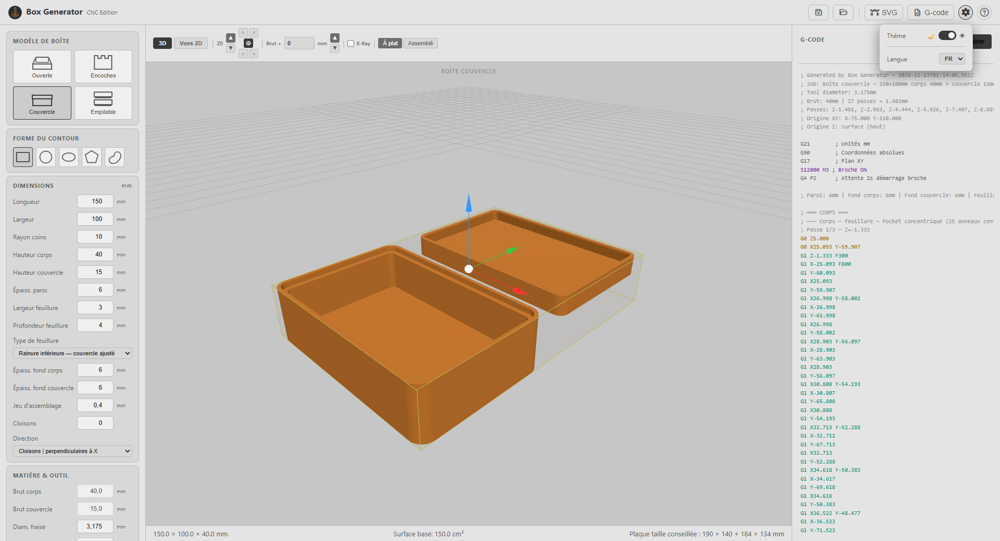

# Box Generator — CNC Edition

Application desktop de génération de boîtes paramétriques avec export G-code CNC.

[Read in English](README.md)

## Fonctionnalités

- **4 types de boîtes** : Plateau ouvert, Boîte finger joint, Boîte à couvercle (feuillure), Boîte empilable
- **6 profils de forme** : Rectangle, Cercle, Ovale, Polygone (dont hexagone), Bean, et toutes variantes arrondies
- **Export G-code** compatible Grbl, Mach3 et LinuxCNC
- **G-code compact** : petits segments regroupés en arcs G2/G3 (option), fichiers beaucoup plus courts
- **Export SVG** de fabrication, en mm, en trois calques (découpe, usinages, repères) : découpe laser, Inkscape, Fusion 360
- **Aperçu 3D** (Three.js) avec repère Z0 et brut ; boîtes à couvercle et à encoches *à plat* ou *assemblées*
- **Vues 2D techniques** : dessus, face, côté et coupe A-A, avec cotes
- **Simulation d'usinage** : rejoue le G-code exporté sur le brut (fraise, trajets, matière enlevée, temps estimé), deux faces pour la boîte empilable, « pièce finie seule »
- **Onglets de maintien** sur les coupes de contour (8 × 2 mm par défaut ; largeur, hauteur, nombre configurables)
- **Stratégies d'entrée** : plongée directe, rampe, hélicoïdale, lead-in tangentiel
- **Finition des parois** : surépaisseur laissée aux passes, puis une passe à pleine profondeur sur la cote
- **Poche concentrique ou raster**, avec **cloisons** (compartiments)
- **Dog-bone** aux coins intérieurs pour les finger joints
- **Origine programme (WCS)** : centre, avant-gauche, avant-droit, arrière-gauche, arrière-droit — dessus ou dessous du brut
- **Sauvegarde/chargement de session** (JSON)
- **Interface FR / EN**

## Interface

| Mode sombre | Mode clair |
|---|---|
|  |  |

## Types de boîtes

| Type | Description |
|------|-------------|
| Plateau ouvert | Plateau simple — cavité + contour extérieur |
| Finger Joint Box | Boîte fermée avec encoches sur tous les panneaux |
| Boîte à couvercle | Corps + couvercle à feuillure (intérieure ou extérieure) |
| Boîte empilable | Boîte avec jonc d'emboîtement pour empilage |

## Formes

Rectangle, Cercle, Ovale, Polygone (N côtés, emprise exacte quel que soit le rayon de coin), Bean (forme organique asymétrique).

Toutes les formes supportent un rayon de coin. Les formes non rectangulaires n'affichent pas les panneaux de parois qui n'ont pas de sens.

## Export SVG

Les pièces sont exportées à plat, en millimètres, avec les mêmes contours que le G-code (cloisons et couvercle compris). Trois calques Inkscape : **Découpe** (rouge, contours traversants), **Usinages** (bleu, poches non traversantes) et **Repères** (noms des pièces, à masquer avant découpe). Utilisable en découpe laser (par ex. LightBurn, avec compensation du kerf) ou comme base dans Inkscape / Fusion 360.

## G-code

- G-code CNC standard (G21, G90, G17)
- Passes en Z multiples avec profondeur par passe configurable
- Offset brut pour les planches légèrement surdimensionnées (la dernière passe de contour atteint l'épaisseur réelle du brut)
- Boîte à couvercle : même hauteur, corps et couvercle sur un seul brut ; hauteurs différentes, **deux bruts séparés aux épaisseurs correspondantes**. Chaque pièce peut être exportée seule : recentrée à l'origine, avec son brut dans l'en-tête du fichier
- Formes asymétriques : le couvercle est fraisé en miroir pour s'emboîter correctement après retournement physique

## Installation

### Prérequis

- [Node.js](https://nodejs.org/) 18+
- [Git](https://git-scm.com/)

### Lancer depuis les sources

```bash
git clone https://github.com/zebruo/BoxGenerator.git
cd BoxGenerator
npm install
npm start
```

### Mode développement (avec DevTools)

```bash
npm run dev
```

### Compiler l'installeur Windows

```bash
npm run dist
```

## Stack technique

- **Electron** (shell desktop Node.js)
- **Vanilla JS ES modules** (sans bundler)
- **Canvas 2D** pour la prévisualisation 2D
- **Three.js** pour la prévisualisation 3D et la simulation
- **Clipper** (Boost) pour les décalages et intersections de contours
- **i18next** pour l'internationalisation
- **Font Awesome** pour les icônes

## Structure du projet

```
BoxGenerator/
├── main.js              — Processus principal Electron (IPC : save-gcode, save-svg, sessions)
├── preload.js           — contextBridge → window.electronAPI
├── package.json
└── renderer/
    ├── index.html
    ├── app.js           — Contrôleur principal, état, événements, calcul origine G-code
    ├── styles.css
    ├── assets/          — logo et icônes
    ├── i18n/            — traductions FR / EN
    ├── lib/             — Three.js, Clipper (géométrie, licence Boost)
    └── modules/
        ├── shapes/      — ShapeBase, Rectangle, Circle, Oval, Polygon, Bean
        ├── boxes/       — OpenTray, FingerJointBox, LidBox, StackableBox
        ├── gcode/       — GCodeGenerator, GCodeCompactor, Offset, PocketConcentric, PartitionedPocket
        ├── preview/     — ThreePreview (3D), TechnicalView (vues 2D)
        ├── sim/         — GCodeProgram, StockSim, SimulationView (simulation d'usinage)
        └── export/      — SvgExport
```

## Licence

MIT
