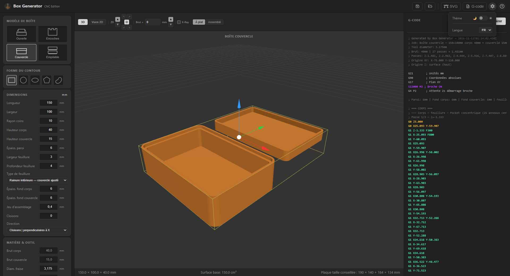
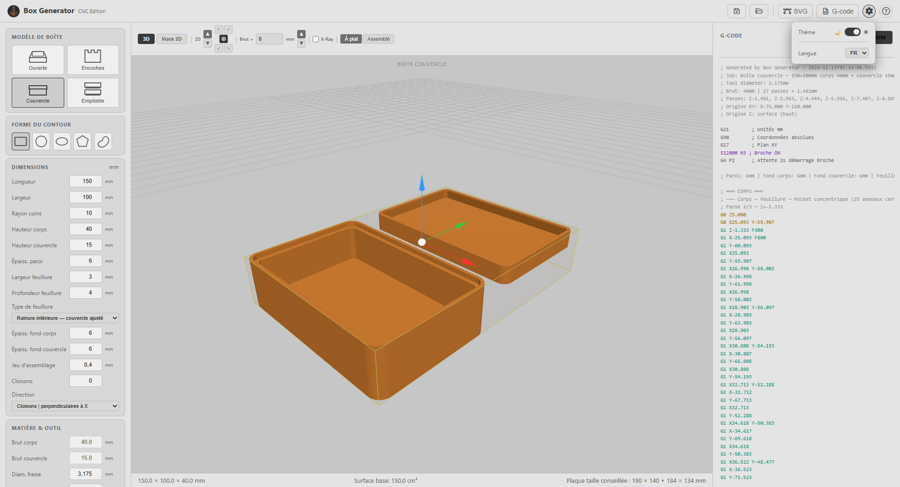

# Box Generator — CNC Edition

A desktop application for generating parametric boxes and trays with CNC G-code export.

[Lire en français](README.fr.md)

## Features

- **4 box types** : Open Tray, Finger Joint Box, Lid Box (rabbet lid), Stackable Box
- **6 shape profiles** : Rectangle, Circle, Oval, Polygon (including hexagon), Bean, and any rounded variant
- **G-code export** compatible with Grbl, Mach3 and LinuxCNC
- **Compact G-code** : short segments merged into G2/G3 arcs (option), much shorter files
- **Manufacturing SVG export** in mm, three layers (cut, machining, labels) : laser cutting, Inkscape, Fusion 360
- **3D preview** (Three.js) with Z0 marker and stock ; lid and finger-joint boxes shown *flat* or *assembled*
- **Technical 2D views** : top, front, side and A-A section, with dimensions
- **Machining simulation** : replays the exported G-code on the stock (tool, paths, removed material, estimated time), two sides for the stackable box, "finished part only"
- **Holding tabs** on contour cuts (8 × 2 mm by default ; configurable width, height, count)
- **Entry strategies** : direct plunge, ramp, helix, tangent lead-in
- **Wall finishing** : allowance left by the passes, then one full-depth pass on the final size
- **Concentric or raster pocket** fill, with **partitions** (compartments)
- **Dog-bone fillets** at inside corners for finger joints
- **Work origin (WCS)** : center, front-left, front-right, back-left, back-right — top or bottom of stock
- **Session save/load** (JSON)
- **FR / EN** interface

## Interface

| Dark mode | Light mode |
|---|---|
|  |  |

## Box types

| Type | Description |
|------|-------------|
| Open Tray | Simple open tray — cavity + outer contour |
| Finger Joint Box | Closed box with finger joints on all panels |
| Lid Box | Body + rabbet lid (interior or exterior rabbet) |
| Stackable Box | Box with interlocking rim for stacking |

## Shapes

Rectangle, Circle, Oval, Polygon (N sides, exact footprint whatever the corner radius), Bean (asymmetric organic shape).

All shapes support corner radius. Non-rectangular shapes automatically omit wall panels where they make no sense.

## SVG export

Parts are exported flat, in millimetres, with the same outlines as the G-code (partitions and lid included). Three Inkscape layers: **Cut** (red, through cuts), **Machining** (blue, blind pockets) and **Labels** (part names, hide before cutting). Usable for laser cutting (e.g. LightBurn, with kerf compensation) or as a base in Inkscape / Fusion 360.

## G-code

- Standard CNC G-code (G21, G90, G17)
- Multiple Z passes with configurable depth-per-pass
- Stock offset for oversize blanks (last contour pass reaches full stock thickness)
- Lid Box: same height, body and lid on one stock ; different heights, **two separate stocks of matching thickness**. Each part can be exported alone: recentered at the origin, with its own stock in the file header
- Asymmetric shapes: lid is mirrored so it fits the body after physical flipping

## Installation

### Prerequisites

- [Node.js](https://nodejs.org/) 18+
- [Git](https://git-scm.com/)

### Run from source

```bash
git clone https://github.com/zebruo/BoxGenerator.git
cd BoxGenerator
npm install
npm start
```

### Development mode (with DevTools)

```bash
npm run dev
```

### Build Windows installer

```bash
npm run dist
```

## Tech stack

- **Electron** (Node.js desktop shell)
- **Vanilla JS ES modules** (no bundler)
- **Canvas 2D** for 2D preview
- **Three.js** for the 3D preview and the simulation
- **Clipper** (Boost) for contour offsets and intersections
- **i18next** for internationalization
- **Font Awesome** for icons

## Project structure

```
BoxGenerator/
├── main.js              — Electron main process (IPC: save-gcode, save-svg, sessions)
├── preload.js           — contextBridge → window.electronAPI
├── package.json
└── renderer/
    ├── index.html
    ├── app.js           — Main controller, state, events, G-code origin computation
    ├── styles.css
    ├── assets/          — logo and icons
    ├── i18n/            — FR / EN translations
    ├── lib/             — Three.js, Clipper (geometry, Boost license)
    └── modules/
        ├── shapes/      — ShapeBase, Rectangle, Circle, Oval, Polygon, Bean
        ├── boxes/       — OpenTray, FingerJointBox, LidBox, StackableBox
        ├── gcode/       — GCodeGenerator, GCodeCompactor, Offset, PocketConcentric, PartitionedPocket
        ├── preview/     — ThreePreview (3D), TechnicalView (2D views)
        ├── sim/         — GCodeProgram, StockSim, SimulationView (machining simulation)
        └── export/      — SvgExport
```

## License

MIT
